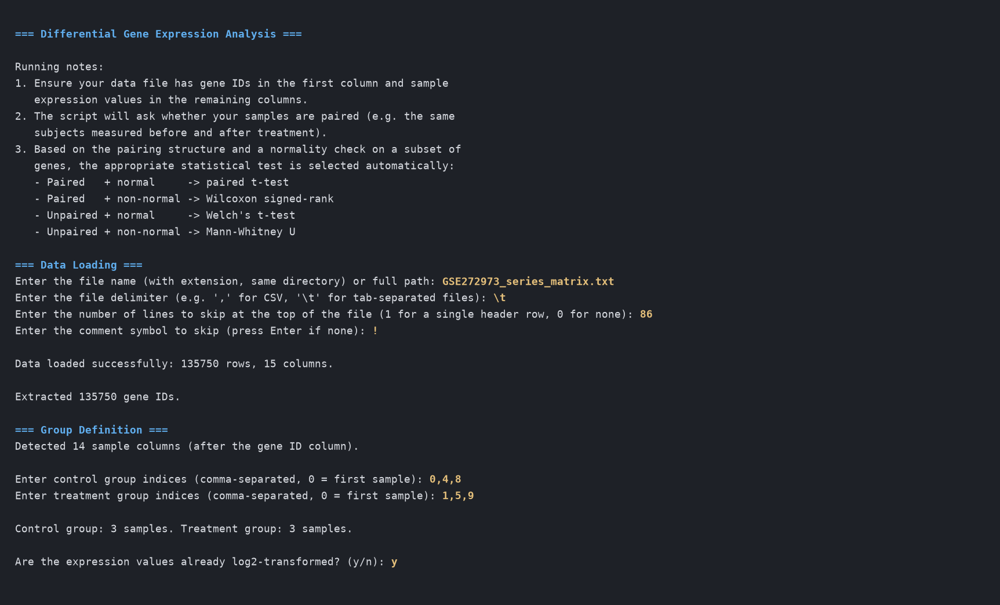
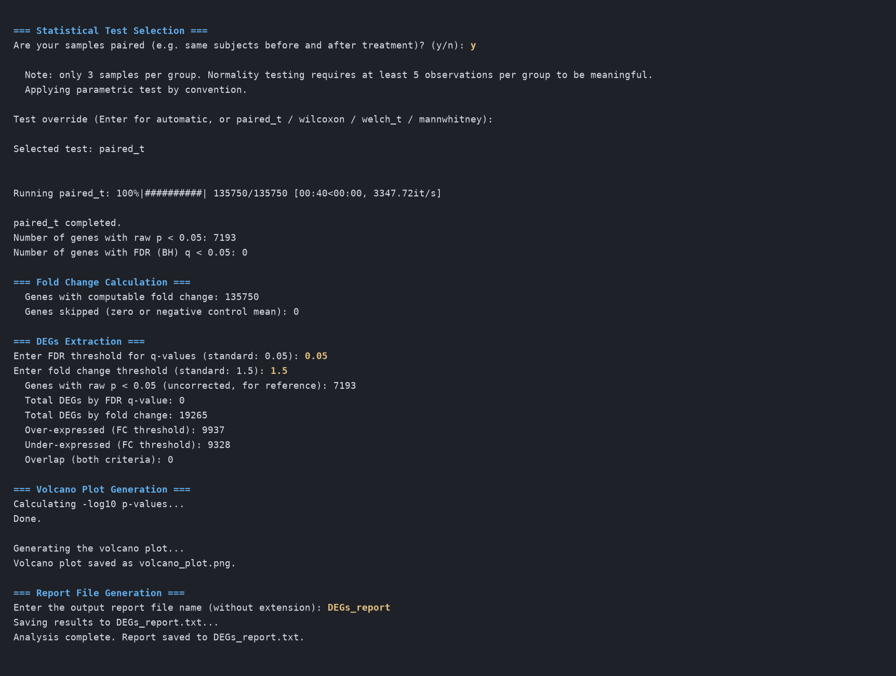

# Differential Gene Expression Command-Line Tool

An interactive Python command-line tool for differential gene expression (DEG) analysis of a gene expression matrix. It selects a suitable statistical test, corrects for multiple testing, computes fold changes, and writes a volcano plot and a tab-separated report. Built as the final project for CIT656: Programming to Bioinformatics, Postgraduate Bioinformatics Diploma at Nile University (2024-2025), and demonstrated on CD19+ B cells from multiple sclerosis (MS) patients before and after apheresis.

**Author:** Mohammed Refaey

Started as a four-person final project for CIT656 with Ahmad Karam Ahmad, Alaa Hamed Mohamed and Omnia Esmail Ebrahim. The current tool was rebuilt by Mohammed Refaey in 2026, with the agreement of the original team.

## Features

- **Flexible input:** any tab- or comma-separated matrix with gene IDs in the first column and samples in the others; header and comment lines can be skipped, so GEO series matrix files work directly.
- **Test selection:** asks whether samples are paired, screens normality with Shapiro-Wilk on a random subset of 200 genes, and picks the test:

  | Design | Normal | Non-normal |
  |---|---|---|
  | Paired | paired t-test | Wilcoxon signed-rank |
  | Unpaired | Welch's t-test | Mann-Whitney U |

  The data count as non-normal when more than 30% of the sampled genes reject normality. With fewer than 5 samples per group the check is skipped and the parametric test is used. The test can also be fixed explicitly.
- **Multiple-testing correction:** Benjamini-Hochberg FDR across all genes; significance is called on q-values, and raw p-values are kept in the report.
- **Fold change on the right scale:** for log2-scaled input (e.g. RMA-normalized microarrays) log2 FC is the difference of group means; for linear input it is log2 of the ratio of means.
- **Outputs:** a volcano plot and a report listing genes by FDR, by fold change, and by both, with the analysis settings in the header.

## Installation

```
git clone https://github.com/MoRefaey21/deg-cli-tool.git
cd deg-cli-tool
pip install -r requirements.txt
```

Requires Python 3.7+ with NumPy, SciPy, Matplotlib and tqdm.

## Usage

```
python differential_gene_expression_analysis.py
```

The tool asks a series of questions. Invalid answers to the file and group questions are caught and asked again.

### Input file

- One row per gene, first column the gene ID, remaining columns numeric expression values (one per sample).
- Tab- or comma-separated. Quotes around gene IDs are removed.
- Lines at the top of the file (metadata, a header row) can be skipped, and lines starting with a comment symbol are ignored.

### Prompts

| Prompt | What to enter |
|---|---|
| File name or path | Path to the expression matrix. |
| Delimiter | `,` for CSV, or `\t` (backslash, t) for tab-separated files. |
| Lines to skip | Number of lines at the top of the file to skip, e.g. `1` for a single header row. |
| Comment symbol | Character that marks lines to ignore (e.g. `!` in GEO series matrices), or Enter for none. |
| Control / treatment indices | Comma-separated 0-based column numbers, counted after the gene ID column. For paired data, list both groups in the same subject order. |
| Log2-transformed? | `y` if values are already on a log2 scale (most normalized microarray data), `n` for linear values such as TPM or normalized counts. |
| Paired? | `y` when the same subjects are measured in both groups. |
| Test override | Enter to accept the automatic choice, or one of `paired_t`, `wilcoxon`, `welch_t`, `mannwhitney`. |
| FDR threshold | Maximum q-value for significance (default 0.05). |
| Fold change threshold | Linear fold change, greater than 1 (default 1.5). Genes with FC >= threshold are over-expressed and FC <= 1/threshold under-expressed. |
| Report name | File name without extension; `.txt` is added. |

### Example session

A real run on the example dataset below (answers in yellow):





### Outputs

**`volcano_plot.png`**: log2 fold change against -log10 raw p-value. Genes are coloured only when they pass both the FDR and fold change thresholds (orange: over-expressed, blue: under-expressed); the dashed vertical lines mark the fold change threshold, and the dashed horizontal line marks the largest p-value still called significant (drawn only if any gene is significant).

**`<name>.txt`**: a header with the settings and counts, then three tab-separated tables: genes passing FDR, genes passing fold change, and genes passing both. Columns:

| Column | Meaning |
|---|---|
| `Gene_ID` | ID from the first column of the input |
| `FC`, `log2FC` | Fold change of treatment over control |
| `P_value` | Raw p-value of the selected test |
| `FDR_q_value` | Benjamini-Hochberg adjusted p-value |
| `Test_statistic` | Statistic of the selected test (for t-tests, positive means the control mean is higher) |
| `Change_Type` | Over-expressed, Under-expressed, or Within FC thresholds |

Rows from the example report:

```
Gene_ID              FC        log2FC     P_value    FDR_q_value  Test_statistic  Change_Type
TC0100006436.hg.1    0.587254  -0.767943  0.0507728  0.905412     4.26716         Under-expressed
TC0100006441.hg.1    1.56306   0.644377   0.359824   0.908767     -1.17849        Over-expressed
```

## Example: B cells in MS before and after apheresis

The example outputs in this repository (`DEGs_report.txt`, `volcano_plot.png`) come from GEO **GSE272973** (Clariom D microarray, RMA-normalized log2 values, 135,750 transcript clusters), using the CD19+ B cell samples of 3 patients taken before the first and after the last apheresis session.

To reproduce, download `GSE272973_series_matrix.txt.gz` from GEO, unzip it, and answer: delimiter `\t`, lines to skip `86`, comment symbol `!`, control `0,4,8`, treatment `1,5,9`, log2 `y`, paired `y`, test override Enter, FDR `0.05`, fold change `1.5`.

**Result.** The paired t-test was selected. No gene passed FDR < 0.05 (the lowest q-value is about 0.5). 7,193 genes had raw p < 0.05, about what chance alone gives across 135,750 tests (around 6,800), and the 19,265 genes with |FC| > 1.5 split almost evenly between up (9,937) and down (9,328). With only three patient pairs the design has little power, so this example shows the tool working end to end on real data rather than a biological finding about apheresis.

## Limitations

- Gene-wise tests do not share information across genes the way limma or DESeq2 do, so small studies have low power.
- Covariates (age, sex, batch) cannot be modelled.
- RNA-seq counts should be normalized and log-transformed before use (e.g. log2 CPM), then analysed with log2 = `y`.

## Repository contents

- `differential_gene_expression_analysis.py`: main script
- `log2_fc.py`, `log10_p.py`, `volcano_plot.py`: helper functions
- `DEGs_report.txt`, `volcano_plot.png`: example outputs (GSE272973)
- `docs/`: screenshots of an example session
- `requirements.txt`, `LICENSE`, `.gitignore`

## Data

GSE272973 is publicly available from GEO and is not included in this repository.
